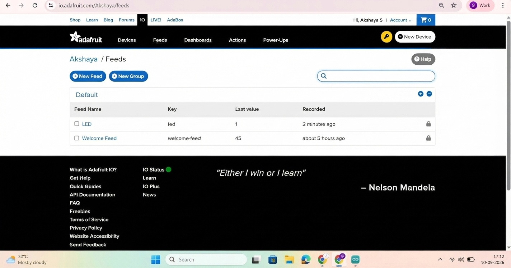
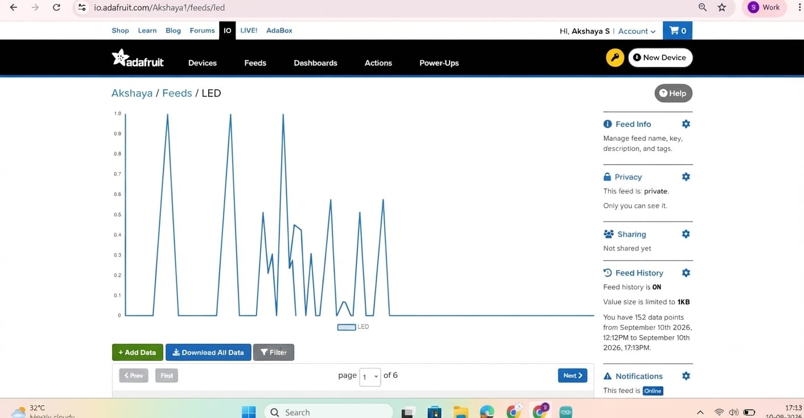
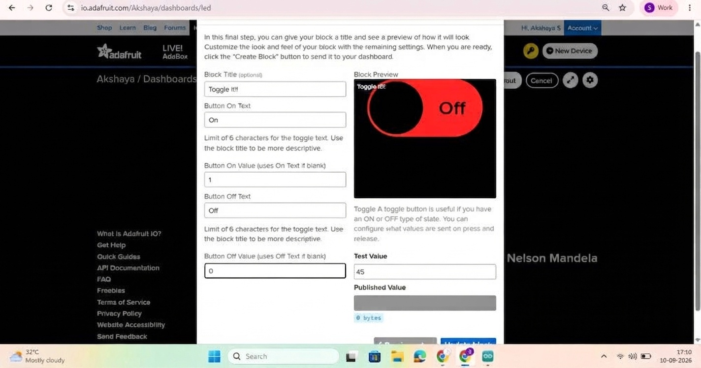
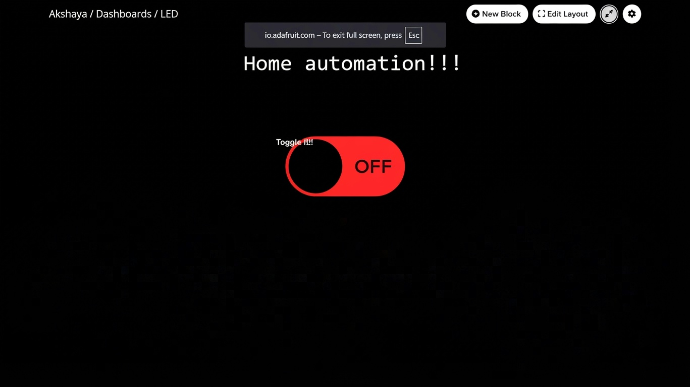
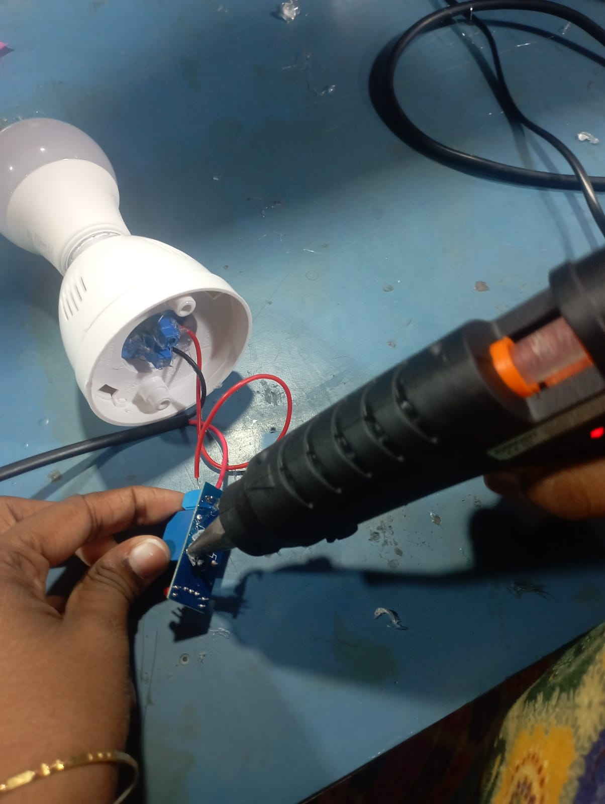
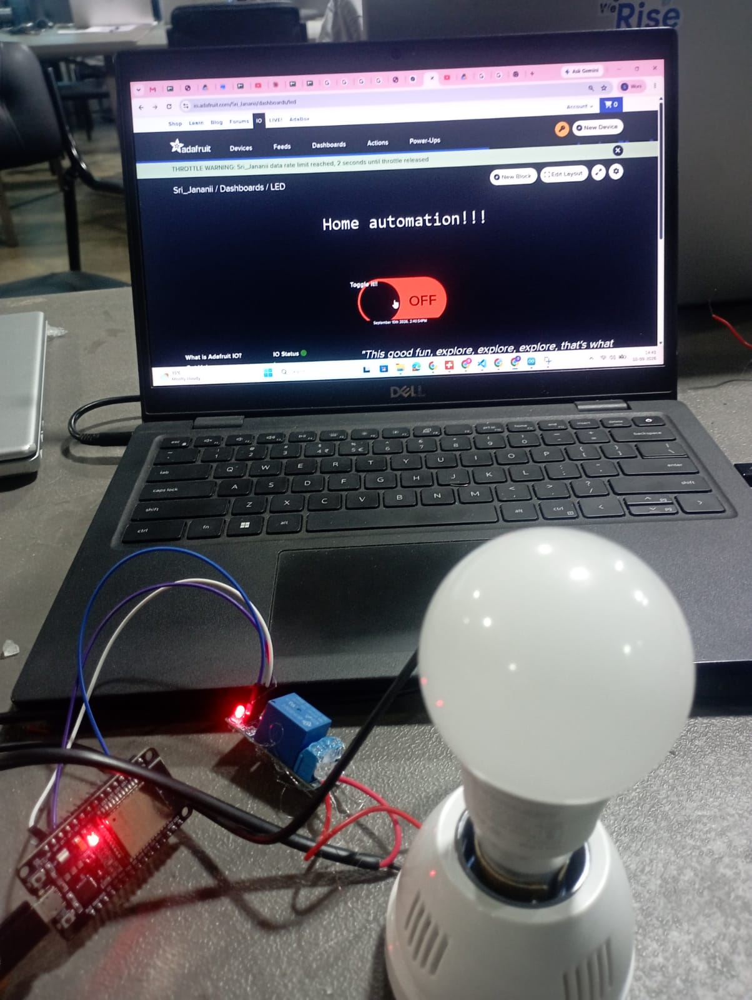
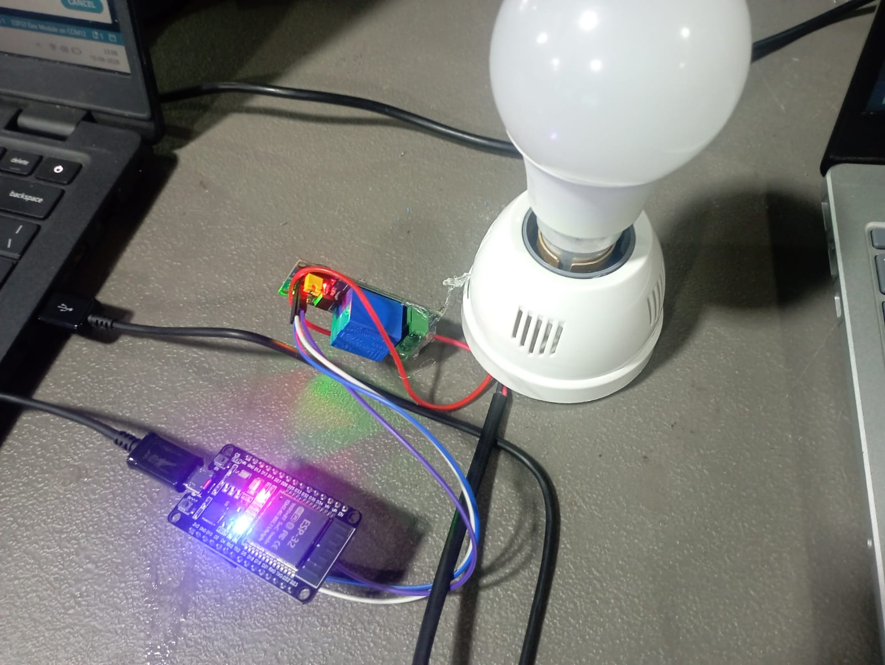

# 🌐 Adafruit IO Dashboard & MQTT — LED and Relay-Controlled Bulb


## 📌 Project Overview

This project demonstrates an IoT-based control system using an ESP32, Adafruit IO, and the MQTT communication protocol. A cloud dashboard sends ON and OFF commands to control an LED and a relay module connected to a bulb.

Unlike a local web server, this system uses a cloud-based MQTT broker, allowing the ESP32 to receive dashboard commands over an internet connection.

## 🎯 Objectives

- Understand the fundamentals of MQTT communication.
- Connect an ESP32 to the Adafruit IO cloud platform.
- Create a dashboard toggle to send control commands.
- Subscribe to an MQTT feed and process incoming messages.
- Control an LED and relay through cloud-based commands.
- Understand the importance of safe hardware integration.

## 🧠 Concepts

### What is Adafruit IO?

Adafruit IO is a cloud platform for IoT projects. It provides feeds for storing data, dashboards for controlling devices, and an MQTT service for exchanging messages.

### What is MQTT?

MQTT stands for Message Queuing Telemetry Transport. It is a lightweight messaging protocol that uses a publish/subscribe model.

### MQTT Roles

| Role | Description in This Project |
|---|---|
| Publisher | The Adafruit IO dashboard publishes ON/OFF values. |
| Subscriber | The ESP32 subscribes to the LED feed. |
| Broker | Adafruit IO receives and forwards MQTT messages. |
| Topic/Feed | The LED feed carries the control values. |

**MQTT topic format:** `<AIO_USERNAME>/feeds/led`

**Payload values:**
- `1` — ON
- `0` — OFF

## 🛠️ Hardware Requirements

- ESP32 development board
- Onboard LED or external LED with a suitable current-limiting resistor
- 5V single-channel relay module compatible with the ESP32 control signal
- Bulb and suitable holder
- Connecting wires
- USB cable
- Computer with Arduino IDE

## 💻 Software and Technologies

- Arduino IDE
- ESP32 board support package
- Adafruit IO account
- Adafruit IO Arduino library
- Wi-Fi connectivity
- MQTT protocol
- Serial Monitor at 115200 baud

## ☁️ Adafruit IO Setup

1. Create an account on Adafruit IO.
2. Open the **Feeds** section.
3. Create a feed named `LED`.
4. Create a dashboard named `Home automation`.
5. Add a Toggle block to the dashboard.
6. Connect the Toggle block to the `LED` feed.
7. Configure the ON value as `1` and the OFF value as `0`.
8. Obtain the Adafruit IO username and key from your account settings.

The ESP32 uses these credentials to connect to Adafruit IO.

## 🔄 System Architecture

```text
Adafruit IO Dashboard
         |
         | ON/OFF command
         v
   MQTT Broker
   Adafruit IO
         |
         | LED feed
         v
       ESP32
       /   \
      v     v
    LED    Relay
              |
              v
             Bulb
```

## 📂 Project Structure

```text
Adafruit-IO-MQTT-LED-Relay-Control/
├── README.md
├── src/
│   └── adafruit_io_mqtt_relay.ino
├── screenshots/
│   ├── task2-photo2.jpeg
│   ├── task2-photo3.jpeg
│   ├── task2-photo4.jpeg
│   ├── task2-photo5.jpeg
│   ├── task2-photo9.jpeg
│   ├── task2-photo10.jpeg


```

*This is the intended structure. Update the filenames if your actual files use different names.*

## 📸 Project Screenshots

### 1. Creating the LED Feed


### 2. Feed History


### 3. Toggle Block Configuration


### 4. Home Automation Dashboard


### 5. Relay and Bulb Wiring



### 9. Working Bulb Demonstration


### 10. Final Hardware Setup



*These links will work after the videos are uploaded with the specified filenames.*

## ⚙️ How the System Works

1. The ESP32 connects to the configured Wi-Fi network.
2. It connects to Adafruit IO using the MQTT service.
3. The ESP32 subscribes to the `LED` feed.
4. A user changes the dashboard toggle.
5. Adafruit IO publishes the corresponding value.
6. The ESP32 receives the message and processes it.
7. The ESP32 updates the LED and relay outputs.

## 🚀 How to Run the Project

1. Install Arduino IDE and ESP32 board support.
2. Install the required Adafruit IO Arduino library and its dependencies.
3. Open `src/adafruit_io_mqtt_relay.ino`.
4. Enter your Wi-Fi and Adafruit IO credentials locally.
5. Select the correct ESP32 board and serial port.
6. Upload the sketch to the ESP32.
7. Open the Serial Monitor at 115200 baud.
8. Confirm that the device connects to Adafruit IO.
9. Open your Adafruit IO dashboard.
10. Toggle the control and observe the LED and relay response.

## 🧩 Problems Encountered and Solutions

| Problem | Possible Cause | Solution |
|---|---|---|
| ESP32 cannot connect to Adafruit IO | Incorrect credentials or Wi-Fi configuration | Verify the username, key, and network settings. |
| Dashboard commands are not received | Incorrect feed key or MQTT connection | Check the feed configuration and connection status. |
| Bulb does not switch reliably | Loose relay connection or unsuitable relay wiring | Disconnect power and have the hardware checked by a qualified person. |
| Relay state is incorrect after reboot | Initial output state or saved feed value | Define a safe startup state and verify the intended behavior. |

## 🔒 Safety and Security

- **230V AC can cause fatal electric shock.**
- Disconnect mains power before any wiring or inspection.
- Use an appropriately rated, enclosed relay module and insulated terminals.
- Have mains wiring inspected and completed by a qualified person.
- Test the low-voltage ESP32 and relay control before connecting the mains load.
- Never publish your real Wi-Fi password or Adafruit IO key in a public repository.
- Use placeholders in publicly shared code.

## 📚 Learning Outcomes

- Understanding MQTT publish/subscribe communication.
- Connecting an ESP32 to a cloud IoT platform.
- Creating an interactive Adafruit IO dashboard.
- Receiving feed updates on an ESP32.
- Controlling hardware through cloud messages.
- Troubleshooting communication and hardware issues safely.

## 🪞 Reflection

This project demonstrates how MQTT enables communication between a cloud dashboard and an ESP32 without requiring the dashboard to communicate directly with the device. It also highlights the importance of matching feed configuration, securing credentials, and checking hardware connections when troubleshooting an IoT system.

## 👩‍💻 Author

**Akshaya M**

---

*Task 2 — Adafruit IO Dashboard & MQTT*
